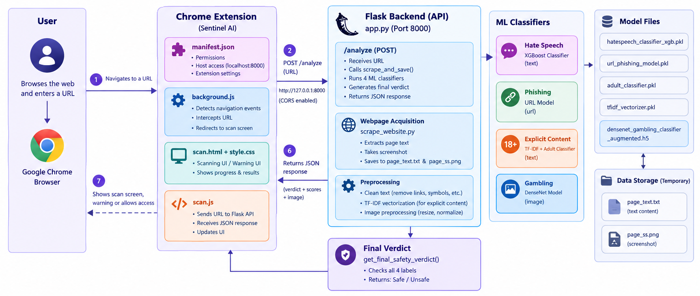
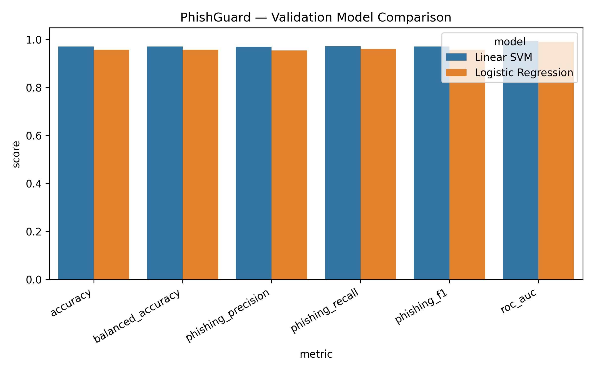

# SafeSearch
### AI-Powered Child Online Safety
**Explore the internet. Not its dangers.**

SafeSearch is an AI-powered browser safety system designed to help children explore the internet with an additional layer of protection. Built using a Chrome extension, a Flask backend, and four machine-learning classifiers, SafeSearch analyzes webpages for potentially harmful content, including hate speech, phishing, explicit content, and gambling-related imagery.

Instead of relying exclusively on static website blocklists, SafeSearch combines URL analysis, text classification, and visual content recognition to assess potential risks on a webpage and present an overall safety verdict.

Our mission is simple: **make online exploration safer for children without taking away the opportunity to learn, discover, and grow.**

---

## The Problem

The internet provides children with incredible opportunities for learning, creativity, and communication. However, not every online experience is safe or age-appropriate.

Children may unexpectedly encounter:

- **Hate speech and harmful language** that can contribute to harassment, cyberbullying, or exposure to discriminatory content.
- **Phishing websites and deceptive links** designed to trick users into revealing personal information or account credentials.
- **Explicit and age-inappropriate content** that children may encounter while browsing seemingly ordinary websites.
- **Gambling-related content and promotions** that may expose young audiences to risky behavior.

Traditional filtering solutions can depend on known blocked URLs or broad website categories. Such approaches may not identify every newly created website or harmful element embedded within an otherwise legitimate page.

Children also may not recognize deceptive links, inappropriate content, or potentially harmful online material on their own.

### The challenge

**How can we identify potentially harmful webpage content proactively, rather than relying only on known blocked websites?**

SafeSearch explores a solution by analyzing multiple aspects of a webpage through specialized AI models.

---

## Our Solution

**SafeSearch** is an AI-powered Chrome extension designed to make browsing safer for children by identifying potentially harmful websites before users interact with them. Instead of relying only on static blocklists or predefined website categories, SafeSearch combines URL analysis, webpage text classification, and visual content detection to assess potential online risks.

When a user navigates to a webpage, the Chrome extension communicates with a Python Flask backend. The backend extracts webpage text and captures a screenshot, then routes the relevant data through four specialized machine learning models. Their predictions are combined into a unified safety verdict that helps users make more informed browsing decisions.

### Four-Layer AI Safety Analysis

| Detection Layer | Input | Technology | Purpose |
|---|---|---|---|
| Hate Speech Detection | Extracted webpage text | XGBoost-based classifier | Identifies potentially hateful or abusive language. |
| Phishing Detection | Webpage URL | Trained URL classification model | Flags URLs predicted to be associated with phishing. |
| Explicit Content Detection | Extracted webpage text | TF-IDF vectorization and a trained classifier | Detects text associated with adult or explicit content. |
| Gambling Detection | Webpage screenshot | DenseNet121-based image classifier | Identifies visual content predicted to be associated with gambling. |

### Unified Safety Verdict

SafeSearch combines the outputs of all four classifiers into a single, easy-to-understand result.

- **Unsafe:** Returned when one or more classifiers identify a configured unsafe category.
- **Safe:** Returned when none of the classifiers identifies a configured unsafe category.

The system also returns individual model confidence values, where available, to support a more detailed view of the analysis.

### What Makes SafeSearch Different?

- **Multimodal detection:** Examines URLs, text, and visual webpage content rather than relying on a single input type.
- **Specialized classifiers:** Uses separate models for distinct categories of online risk.
- **Unified risk assessment:** Converts multiple predictions into one overall safety verdict.
- **Browser integration:** Connects AI-based analysis with a Chrome extension for a familiar browsing experience.
- **Extensible architecture:** Allows additional detection categories

---

## System Architecture

  

### How the pipeline works

1. **Navigation monitoring:** The Chrome extension detects a top-level navigation and initiates the scanning workflow.
2. **Webpage acquisition:** The extension sends the target URL to the Flask API.
3. **Content extraction:** The backend uses `scrape_website.py` to extract text and capture a screenshot.
4. **AI inference:** The relevant text, URL, and screenshot are processed by the four trained classifiers.
5. **Verdict aggregation:** The backend combines the predicted labels using predefined safety rules.
6. **Result delivery:** The API returns the verdict, category labels, confidence scores, and screenshot data.
7. **Browser response:** The extension displays the analysis and provides navigation choices.

---

## Machine Learning Approach

### 1. Hate Speech Detection

- **Input:** Extracted webpage text.
- **Preprocessing:** Lowercasing, URL removal, and removal of non-alphabetic characters.
- **Model:** Trained XGBoost classifier.
- **Output:** `Hate` or `Non-hate`, with a confidence score.

This module helps identify potentially hateful language in webpage text.

### 2. Phishing URL Detection

Classify URLs as `phishing` or `legitimate` using `dataset_phishing_processed.csv`.

- **Features:** Character-level TF-IDF (3–5 character n-grams, up to 200K features) combined with engineered URL features such as URL length, subdomains, special characters, digit ratios, and phishing indicators.
- **Preprocessing:** Missing-value handling, duplicate cleaning, numerical imputation and scaling, and stratified dataset splitting.
- **Models:** Linear SVM (`LinearSVC`) and Logistic Regression, evaluated using precision, recall, F1-score, and ROC-AUC.
- **Selected Model:** Linear SVM, achieving **97.16% accuracy**, **97.26% phishing recall**, and **0.9941 ROC-AUC**.

#### 📊 Model Results

| Metric | Linear SVM | Logistic Regression |
|---|---:|---:|
| Accuracy | **97.16%** | 95.84% |
| Precision | 97.05% | 95.54% |
| Recall | **97.26%** | 96.17% |
| F1-score | **97.16%** | 95.86% |

#### 📈 Visualizations

**Model Comparison**

**Confusion Matrix**

**ROC Curve**

**Feature Analysis**

### 3. Explicit Content Detection

- **Input:** Extracted webpage text.
- **Preprocessing:** Text cleaning followed by TF-IDF vectorization.
- **Model:** Trained adult-content classifier.
- **Output:** `Adult` or `Non-adult`, with a confidence score.

This module identifies potentially explicit text and can help flag age-inappropriate material.

### 4. Gambling Image Detection

- **Input:** Captured webpage screenshot.
- **Preprocessing:** Resize to 224 × 224 pixels, normalize pixel values, and prepare the image tensor.
- **Model:** DenseNet121-based image classifier.
- **Output:** `gambling` or `non_gambling`, with a confidence score.

This module uses visual patterns to identify gambling-related imagery.

### Final Safety Verdict

The current implementation uses rule-based aggregation. If any of the four classifiers returns its configured unsafe label, the final verdict is `Unsafe`; otherwise, the verdict is `Safe`.

This approach is easy to interpret and demonstrates how multiple models can contribute to one browser safety decision. Its effectiveness depends on the quality of the individual models and their evaluation.

---

## 🎯 Our Vision

We believe children should be able to explore the internet with fewer unexpected encounters with harmful content.

SafeSearch brings together text analysis, URL classification, and image recognition to demonstrate how AI can contribute to a more proactive approach to online safety.

**Safer browsing. Smarter detection. A better internet for young explorers.**

---

*Built for a hackathon using Python, Flask, TensorFlow, XGBoost, Scikit-learn, and the Chrome Extensions API.*
